# 12 blanks. 12 with 3D.

**DESIGN:OS Origami** · Python ≥3.10 · [MIT](LICENSE)

DESIGN:OS Origami generates parametric carton dielines, printer exchange files and source-derived folding previews from Python.

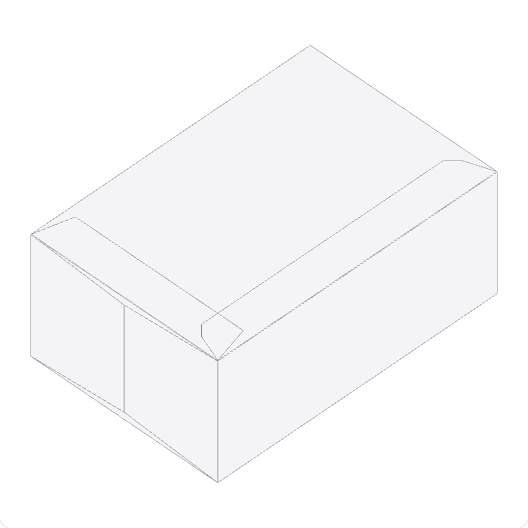

One generated tuck blank. 100% fold progress. A rigid-panel visualization does not certify physical assembly.

Source: `TuckBox_80x50x120` · blank 275.9 × 250.45 mm · caliper 0.5 mm.

Fold gate: 4 / 4 samples pass (25%, 50%, 75%, 100%). Twelve shared edges stay within a 0.5 mm gap tolerance. All 12 catalogue blanks have a qualified 3D preview. [Measured catalogue](docs/assets/catalog.json).

## Choose the workflow for the job

| Task | Drawing / separate inspection | DESIGN:OS Origami |
| --- | --- | --- |
| Geometry changes | Edit a drawing and inspect each changed path. | Regenerate from dimensions and caliper; inspect the result. |
| Printer handoff | Specify the recipient’s layers, spots and scale. | Start from an explicit five-spot PDF and mm/y-up printer DXF; still qualify the recipient. |
| Fold inspection | Fold a sample or use a separate simulation workflow. | Inspect source-derived rigid-panel motion when the continuity gate permits it. |
| Physical qualification | Check material, fit and manufacturing behaviour. | The same physical checks remain necessary; the preview does not replace them. |

Use a recipient-qualified CAD/prepress workflow for accepted manufacturing exchange. Use a physical sample to establish fold/fit. These generated files and previews do not establish either outcome.

## One blank, multiple outputs

- Generate 11 parametric carton products as 12 separate SVG and presentation DXF blanks.
- Export a printer profile with five named spots, 1 pt PDF strokes, a legend and 3 mm default bleed.
- Inspect source-derived rigid-panel motion when the sampled continuity gate permits a 3D preview.

The topology tests check a single CUT contour, connectivity and slit attachment. These structural checks do not establish physical foldability.

## Use with your AI agent

Install a generated local package for [Claude Code](docs/ai-hosts/claude-code.md),
[Codex CLI](docs/ai-hosts/codex-cli.md), [Gemini CLI](docs/ai-hosts/gemini-cli.md),
or [Grok Build CLI](docs/ai-hosts/grok-build.md). [Claude Desktop](docs/ai-hosts/claude-desktop.md)
and [Cursor](docs/ai-hosts/cursor.md) use manual local stdio MCP configuration.
Start with [local setup](docs/ai-hosts/local-setup.md), then the selected host guide.

Gemini CLI installation and discovery were observed; execution was blocked by
Gemini sign-in on the test machine. Gemini support remains unqualified.

```sh
python3 scripts/skill_contract.py --check
python3 scripts/sync_host_bundles.py --check
python3 scripts/host_config.py --host codex --workspace "$HOME/OrigamiRuns" \
  --browser-cache "$HOME/.cache/origami-cad-browser"
```

The renderer prints resolved configuration; it does not write host settings.
Each host guide supplies its install command. The canonical
[es-origami-cad skill](skills/es-origami-cad/SKILL.md) follows Concept → Build →
Check → Hand over → Adjust through the same product engine. Bundles are generated
regular-file copies, never independent engines or hand-edited mirrors.

Run the [host smoke](docs/ai-hosts/verification.md) after installation. Tool
discovery and manifest validation alone do not establish host support. Desktop
and Cursor GUI acceptance are owner-manual; Grok Build requires the official
binary. No hosted server, remote MCP or ChatGPT/Grok consumer connector is shipped.
Physical fold/fit and recipient import remain NOT VERIFIED. The current default
0.45t allowance at 90° differs from the mandated π(R + Kt)/2; this packaging does
not resolve that known formula conflict.

## Quickstart from a checkout

From the repository checkout, with Python ≥3.10. The first command uses presentation mode; the second adds the printer profile.

```sh
PYTHONPATH=src python3 -m origami_cad.cli generate --type tuck-box --output-dir output
PYTHONPATH=src python3 -m origami_cad.cli generate --type tuck-box --profile printer --output-dir output
find output -maxdepth 1 -type f | sort
```

The sorted file list for this tuck-box run:

```text
output/TuckBox_80x50x120.dxf
output/TuckBox_80x50x120.svg
output/TuckBox_80x50x120_printer.dxf
output/TuckBox_80x50x120_printer.pdf
output/TuckBox_80x50x120_viewer.html
```

### First safe use

1. Generate the presentation files and inspect the full SVG blank. Keep each earlier delivery in a separate output directory before regenerating.
2. Generate the printer profile and inspect its PDF legend, spot names, bleed and dimensions at 100% scale.
3. Open the generated viewer, inspect available fold motion, then qualify RIP/CAD import and physical fold/fit with the recipient before manufacturing.

## 11 products. 12 blanks.

Each blank has its own source-generated SVG and separate printer PDF/DXF. Sleeve + tray is a two-piece product: separate sleeve and four-wall tray files, no sheet nesting or assembly fusion. Dimensions below describe each shown blank.

| Product / CLI type | Shown blank / caliper | 3D preview | Source SVG | Printer PDF / DXF |
| --- | --- | --- | --- | --- |
| Tuck box / `tuck-box` | 275.9 × 250.4 mm / 0.5 mm | 3D preview available | [SVG](docs/assets/models/tuck-box.svg) | [PDF](docs/assets/models/tuck-box.pdf) / [DXF](docs/assets/models/tuck-box.dxf) |
| Hexagonal petal box / `hex-petal` | 244.9 × 217.7 mm / 0.4 mm | 3D preview available | [SVG](docs/assets/models/hex-petal.svg) | [PDF](docs/assets/models/hex-petal.pdf) / [DXF](docs/assets/models/hex-petal.dxf) |
| Diamond faceted box / `diamond-box` | 252.0 × 140.0 mm / 0.45 mm | 3D preview available | [SVG](docs/assets/models/diamond-box.svg) | [PDF](docs/assets/models/diamond-box.pdf) / [DXF](docs/assets/models/diamond-box.dxf) |
| Zero-glue tray / `zero-glue-tray` | 220.0 × 190.0 mm / 0.5 mm | 3D preview available | [SVG](docs/assets/models/zero-glue-tray.svg) | [PDF](docs/assets/models/zero-glue-tray.pdf) / [DXF](docs/assets/models/zero-glue-tray.dxf) |
| Gable handle box / `gable-box` | 567.9 × 304.6 mm / 0.5 mm | 3D preview available | [SVG](docs/assets/models/gable-box.svg) | [PDF](docs/assets/models/gable-box.pdf) / [DXF](docs/assets/models/gable-box.dxf) |
| Pillow box / `pillow-box` | 272.9 × 135.4 mm / 0.5 mm | 3D preview available | [SVG](docs/assets/models/pillow-box.svg) | [PDF](docs/assets/models/pillow-box.pdf) / [DXF](docs/assets/models/pillow-box.dxf) |
| Crash-lock box / `crash-lock-box` | 295.9 × 196.4 mm / 0.5 mm | 3D preview available | [SVG](docs/assets/models/crash-lock-box.svg) | [PDF](docs/assets/models/crash-lock-box.pdf) / [DXF](docs/assets/models/crash-lock-box.dxf) |
| FEFCO 0201 RSC / `fefco-0201` | 730.9 × 270.2 mm / 0.5 mm | 3D preview available | [SVG](docs/assets/models/fefco-0201.svg) | [PDF](docs/assets/models/fefco-0201.pdf) / [DXF](docs/assets/models/fefco-0201.dxf) |
| FEFCO 0427 mailer / `fefco-0427` | 478.5 × 468.2 mm / 0.5 mm | 3D preview available | [SVG](docs/assets/models/fefco-0427.svg) | [PDF](docs/assets/models/fefco-0427.pdf) / [DXF](docs/assets/models/fefco-0427.dxf) |
| Sleeve + tray · sleeve / `sleeve-tray` | 336.9 × 81.0 mm / 0.5 mm | 3D preview available | [SVG](docs/assets/models/sleeve-tray-sleeve.svg) | [PDF](docs/assets/models/sleeve-tray-sleeve.pdf) / [DXF](docs/assets/models/sleeve-tray-sleeve.dxf) |
| Sleeve + tray · tray / `sleeve-tray` | 190.2 × 150.2 mm / 0.5 mm | 3D preview available | [SVG](docs/assets/models/sleeve-tray-tray.svg) | [PDF](docs/assets/models/sleeve-tray-tray.pdf) / [DXF](docs/assets/models/sleeve-tray-tray.dxf) |
| Hinged food box / `food-box` | 300.2 × 405.4 mm / 0.5 mm | 3D preview available | [SVG](docs/assets/models/food-box.svg) | [PDF](docs/assets/models/food-box.pdf) / [DXF](docs/assets/models/food-box.dxf) |

### Tuck box

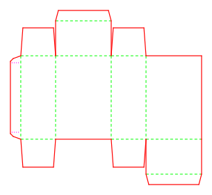

275.9 × 250.4 mm blank · 0.5 mm caliper. 3D preview available. [Preview](docs/demo/index.html?model=tuck-box).

### Hexagonal petal box

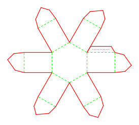

244.9 × 217.7 mm blank · 0.4 mm caliper. 3D preview available. [Preview](docs/demo/index.html?model=hex-petal).

### Diamond faceted box

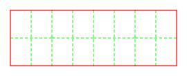

252.0 × 140.0 mm blank · 0.45 mm caliper. 3D preview available. [Preview](docs/demo/index.html?model=diamond-box).

### Zero-glue tray

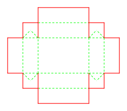

220.0 × 190.0 mm blank · 0.5 mm caliper. 3D preview available. [Preview](docs/demo/index.html?model=zero-glue-tray).

### Gable handle box

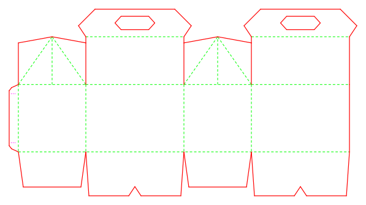

567.9 × 304.6 mm blank · 0.5 mm caliper. 3D preview available. [Preview](docs/demo/index.html?model=gable-box).

### Pillow box

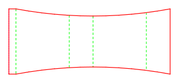

272.9 × 135.4 mm blank · 0.5 mm caliper. 3D preview available. [Preview](docs/demo/index.html?model=pillow-box).

### Crash-lock box

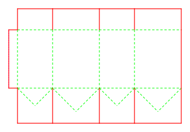

295.9 × 196.4 mm blank · 0.5 mm caliper. 3D preview available. [Preview](docs/demo/index.html?model=crash-lock-box).

### FEFCO 0201 RSC

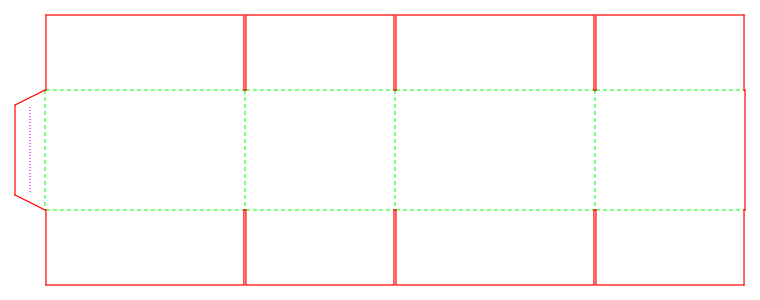

730.9 × 270.2 mm blank · 0.5 mm caliper. 3D preview available. [Preview](docs/demo/index.html?model=fefco-0201).

### FEFCO 0427 mailer

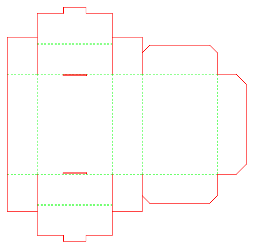

478.5 × 468.2 mm blank · 0.5 mm caliper. 3D preview available. [Preview](docs/demo/index.html?model=fefco-0427).

### Sleeve + tray · sleeve

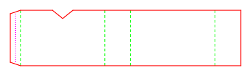

336.9 × 81.0 mm blank · 0.5 mm caliper. 3D preview available. [Preview](docs/demo/index.html?model=sleeve-tray-sleeve).

### Sleeve + tray · tray

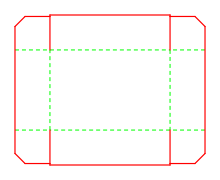

190.2 × 150.2 mm blank · 0.5 mm caliper. 3D preview available. [Preview](docs/demo/index.html?model=sleeve-tray-tray).

### Hinged food box

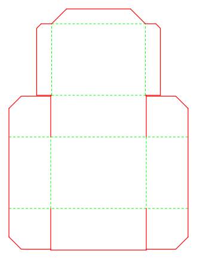

300.2 × 405.4 mm blank · 0.5 mm caliper. 3D preview available. [Preview](docs/demo/index.html?model=food-box).

## A handoff with named paths

Export a printer profile with five named spots, 1 pt PDF strokes, a legend and 3 mm default bleed.

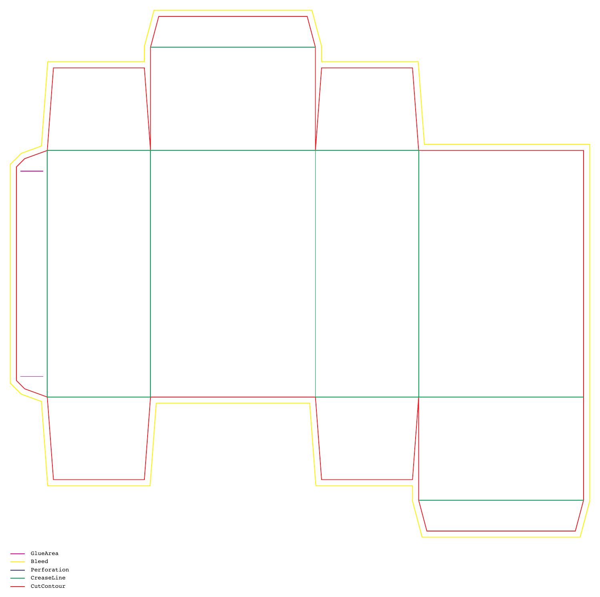

Actual PDF raster · default 3 mm bleed · five spot resources. Print or import at 100% scale.

| Default spot name | Purpose |
| --- | --- |
| `CutContour` | Cut contour |
| `CreaseLine` | Crease paths |
| `Perforation` | Perforation paths |
| `Bleed` | Exterior allowance |
| `GlueArea` | Glue paths |

Printer DXF is R2000 with millimetre units and y-up coordinates. Presentation DXF is the separate R12 drawing export; its recipient unit/orientation profile is unspecified and it loses mountain/valley direction.

The legend uses all five spots even when a particular blank has no paths of a given type. Agree the names, bleed and import settings with the recipient. [Download printer PDF](docs/assets/models/tuck-box.pdf) · [Download printer DXF](docs/assets/models/tuck-box.dxf).

## From flat paths to moving panels

Inspect source-derived rigid-panel motion when the sampled continuity gate permits a 3D preview.

[Open the model switcher](docs/demo/index.html). Rotate, pan and zoom the actual generated viewer; use its fold controls to inspect progress. The 2D drawing remains available if JavaScript, the Three.js r128 CDN or WebGL is unavailable.

## What is NOT verified

- Recipient RIP/CAD import and prepress acceptance are not verified.
- Physical fold/fit, material, grain, tooling and manufacturing tolerances are not verified.
- The baseline samples four positions; coordinated motion also passes 101 samples and endpoint/loop closure checks, with the same 0.5 mm seam tolerance. Continuous-time motion, automatic locking and collision avoidance are not verified.

Score allowances are uncalibrated heuristics. Knowledge documents have mixed provenance; structural lint does not establish their engineering claims.

## Before you cut or fold

<details>
<summary>What does DESIGN:OS Origami generate?</summary>

It generates 11 parametric carton products as 12 separate SVG and presentation DXF blanks, standalone viewers, and a separate printer profile with spot-colour PDF and R2000 DXF. Sleeve + tray uses two separately named blanks and one file per blank. Miura-ori and deer-base are separate research patterns.

</details>

<details>
<summary>Which cartons have a 3D fold preview?</summary>

All 12 shown catalogue blanks (Tuck box, Hexagonal petal box, Diamond faceted box, Zero-glue tray, Gable handle box, Pillow box, Crash-lock box, FEFCO 0201 RSC, FEFCO 0427 mailer, Sleeve + tray · sleeve, Sleeve + tray · tray, Hinged food box) have qualified source-derived 3D previews. Availability depends on the generated geometry; it does not prove physical fold/fit.

</details>

<details>
<summary>What is in the printer profile?</summary>

The defaults are CutContour, CreaseLine, Perforation, Bleed and GlueArea, with 1 pt PDF strokes, a five-spot legend and 3 mm bleed. Printer DXF is R2000 with millimetre units and y-up coordinates. Recipient RIP/CAD import is not verified.

</details>

<details>
<summary>How do I run it?</summary>

Use Python 3.10 or newer from a checkout and run the Quickstart commands. Presentation mode writes SVG, DXF and viewer HTML; printer mode writes a separate PDF and DXF.

</details>

<details>
<summary>Does the preview prove the carton will fold and fit?</summary>

No. The baseline checks continuity at 25%, 50%, 75% and 100% with a 0.5 mm tolerance. Coordinated crash-lock motion must additionally pass 101 samples and endpoint/loop closure checks. The preview does not prove continuous-time motion, collision avoidance, material behaviour, glue closure or physical fold/fit.

</details>

<details>
<summary>What are the license and browser requirements?</summary>

Original repository work is MIT licensed; third-party references retain their own rights. The static landing page has no analytics, cookies or widgets. The embedded viewer requires JavaScript, WebGL and the pinned Three.js r128 CDN; its 2D dieline remains available when 3D cannot load.

</details>

## Read the contracts

- [Printer profile: spots, bleed, scale and exchange limits](docs/printer-profile.md)
- [Fold preview: extraction, continuity and motion limits](docs/fold-preview.md)
- [CLI choices, parameters and filenames](src/origami_cad/cli.py)

The public display name is DESIGN:OS Origami. Package metadata remains `design-os-origami-cad`. [GitHub](https://github.com/jangtrinh/design-os-origami) · [Website](https://jangtrinh.github.io/design-os-origami/). Publication and remote availability are not verified.
